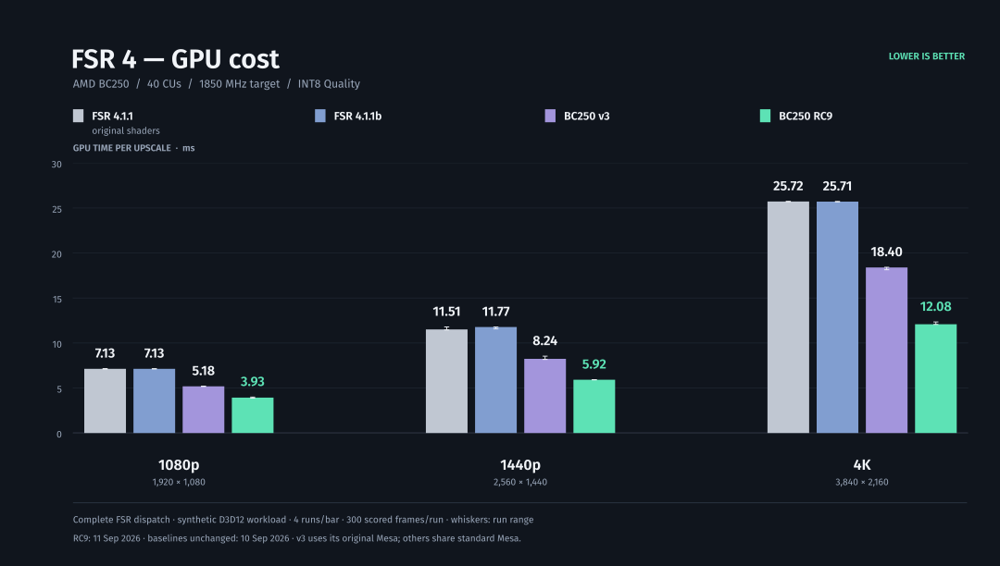
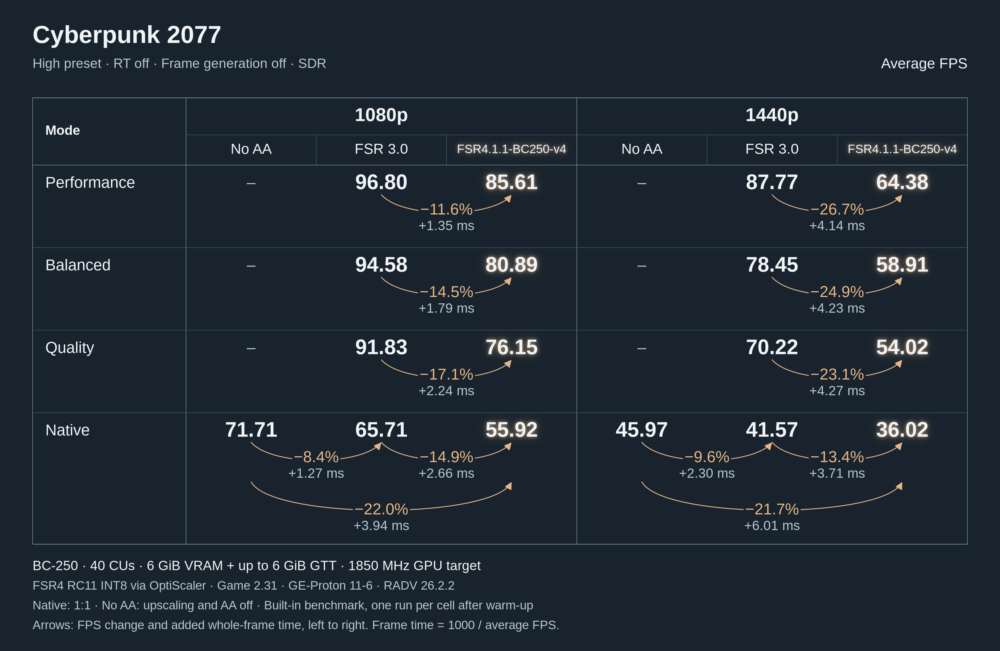

# BC250 FSR4

**FSR 4.1.1 INT8 optimizations in one DLL.** Replace the upscaler DLL in
OptiScaler or a compatible native FidelityFX game. Use your normal graphics
driver and Proton.

**[Install across your games](docs/optiscaler-client.md)** ·
[Manual installation](docs/beginner-guide.md) ·
[Download the DLL](https://github.com/daniel-h-0/bc250-fsr4-fork/releases/download/v4.0.0-rc12/bc250-fsr4-dll-4.0.0-rc12.zip) ·
[All documentation](docs/README.md)

## Install

1. Open the [BC250 build of OptiScaler Client](docs/optiscaler-client.md) and scan your library.
2. Choose **Install across your games**. The client includes RC11 and its
   FFX/INT8 settings. For RC12, choose **Import DLL ZIP** once with the
   [RC12 DLL ZIP](https://github.com/daniel-h-0/bc250-fsr4-fork/releases/download/v4.0.0-rc12/bc250-fsr4-dll-4.0.0-rc12.zip).
3. Select games and install. Each game shows any first-time loading step.
4. Retain working launch options and launch normally. Import future DLL ZIPs once
   to update selected games together.

Prefer to copy the DLL yourself? The [manual guide](docs/beginner-guide.md) covers
OptiScaler setup and custom paths. [Native FidelityFX games](docs/beginner-guide.md#native-fidelityfx-games)
can use direct replacement without OptiScaler. The client route manages local
OptiScaler copies on Linux; the same setup applies across compatible games.

Testing covers **BC250/Linux**. [Release validation](docs/portable-dll-rc12.md)
shows the supported test scope and work awaiting qualification.
System Mesa 26.2.x before 26.2.3 has an upstream compiler bug that can break other
shaders, e.g. HelixSR frame generation. Update Mesa to 26.2.3 or newer
([details](docs/release-notes-rc11.1.md#affected-downloads-and-system-mesa)).

## Performance

**RC11 costs 3.67 / 5.44 / 11.98 ms per upscale at 1080p / 1440p / 4K Quality,
against 6.66 / 11.32 / 25.24 ms for AMD's original shaders** (October 23, 2026,
Mesa 26.2.1). **RC12 is 0.41 ms faster at 1080p** (3.26 ms, Mesa 26.2.5) and
0.72 ms faster at 1440p Performance with an 8K context maximum. At 1440p and 4K
it matches RC11 (+0.002 ms at 1440p Performance).
[Method and data](docs/gpu-cost.md).

The chart is the September 10–11 campaign (RC9; the baselines retain September 10 data).

The optional [Linux driver package](docs/driver-cache-setup.md) is a private
Mesa/RADV build for selected games: Mesa 26.2.2 + the upstream `nir_opt_uub` fix
since the [RC11.1 driver pre-release](docs/release-notes-rc11.1.md). Paired with
AMD's FSR provider, it applies the optimizations through the graphics driver.

**The DLL and alternative driver deliver the same FSR optimizations**, with
comparable measured GPU cost in the RC10 comparison (RC12's new 1080p and 8K
programs were not compared). The DLL is the simpler install. The driver needs
specific provider/Proton versions and is provided exclusively for compatibility
and convenience. [Comparison](docs/driver-rc10.md#dll-versus-driver).

RC10 reduced cold synthetic setup from **22.24 to 19.38 seconds**, preserving
RC9's native shader code (and runtime performance). RC11 retains RC10's shaders and improves optional tools.
RC12 applies the RC8/RC9 shader work to the 1080p and 8K context families.
[Compilation results](docs/legacy/research/portable-dll-rc10.md) · [Release notes](docs/release-notes-rc12.md).

### What do these timings mean for game FPS?

Those Quality-mode timings measure the time it takes to run the upscaler itself.
Rendering the game at a lower resolution saves work, while FSR4 adds reconstruction cost.
The Cyberpunk 2077 benchmark below shows the combined result in average FPS at 1080p and 1440p.
FSR4 Quality reaches **76.15 / 54.02 FPS**, compared with **71.71 / 45.97 FPS** at
native (1080p / 1440p) resolution with upscaling and AA off.

High preset, RT and frame generation off, SDR; one run per cell after warm-up.
Arrow labels show differences in whole-frame time derived from FPS.
[Method and data](docs/gpu-cost.md#game-fps-cyberpunk-2077).

## Support and development

[Installation troubleshooting](docs/beginner-guide.md#if-the-check-fails) ·
[Client update or restore](docs/optiscaler-client.md#update-or-restore) ·
[Manual update or undo](docs/beginner-guide.md#update-an-existing-installation) ·
[Tested configurations](docs/portable-dll-rc12.md) ·
[Build the DLL](dll/README.md) · [Contribute](CONTRIBUTING.md)

## Special thanks and notes

This continues [dmoraza's BC250 FSR4 project](https://github.com/dmorazasanchez/bc250-fsr4) - many thanks to him for
originating this work and achieving the first bundle of performance wins.

The installer builds on [OptiScaler Client](https://github.com/Optiscaler-Client/Optiscaler-Client),
created by [Agustín Montaña (Agustinm28)](https://github.com/Agustinm28) and contributors.
Their desktop application, game discovery and component management provide the
foundation for our BC250 installation screen. The [OptiScaler](https://github.com/optiscaler/OptiScaler)
team and contributors provide the in-game upscaler adapter and
[OptiPatcher](https://github.com/optiscaler/OptiPatcher) input-compatibility plugin.

Thanks to AMD/GPUOpen, Mesa/RADV, Microsoft DXC, Wine, vkd3d-proton, Valve Proton,
GE-Proton, NVIDIA, Intel, and the Avalonia/.NET contributors.
[Component credits, licenses and our modifications](THIRD_PARTY.md).
GPT-6-Astra was used in the development of this project, with constant human review.
